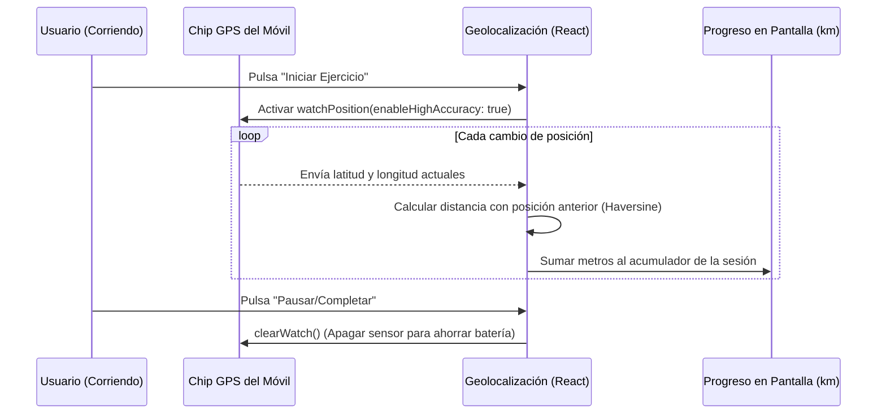

# 🗺️ QuestFit — Arquitectura de GPS, Mapas y Smartwatch

Esta guía detalla la viabilidad técnica y los pasos de desarrollo para integrar el **seguimiento por GPS en tiempo real (conteo automático de kilómetros)** y la **sincronización con Smartwatch** en **QuestFit**.

---

## 📍 1. ¿Cómo contar kilómetros automáticamente con GPS?

Para automatizar el conteo de kilómetros en misiones de Cardio (como "Maratón del Guerrero"), no necesitamos servicios de pago como la API de Google Maps. Los navegadores web modernos (tanto en móviles como dentro de PWAs y wrappers de Capacitor) ofrecen acceso directo a los sensores de posicionamiento globales.

### La API de Geolocalización de HTML5
Utilizaremos `navigator.geolocation.watchPosition()`. A diferencia de `getCurrentPosition` (que solo mide una vez), `watchPosition` se ejecuta en bucle en segundo plano cada vez que el chip GPS del móvil detecta que el usuario se ha movido (cambio de coordenadas).

### Arquitectura de Seguimiento por GPS


### Cálculo Matemático: La Fórmula del Haversine
Como la Tierra es una esfera tridimensional, no podemos restar coordenadas directamente para medir distancias planas. Debemos aplicar la **Fórmula del Semiverseno (Haversine)**, que calcula la distancia más corta entre dos puntos en una esfera a partir de sus latitudes y longitudes:

```typescript
function calculateDistanceInKm(lat1: number, lon1: number, lat2: number, lon2: number): number {
  const earthRadiusKm = 6371; // Radio de la Tierra en kilómetros

  const dLat = (lat2 - lat1) * Math.PI / 180;
  const dLon = (lon2 - lon1) * Math.PI / 180;

  const a = 
    Math.sin(dLat / 2) * Math.sin(dLat / 2) +
    Math.cos(lat1 * Math.PI / 180) * Math.cos(lat2 * Math.PI / 180) * 
    Math.sin(dLon / 2) * Math.sin(dLon / 2);
    
  const c = 2 * Math.atan2(Math.sqrt(a), Math.sqrt(1 - a));
  return earthRadiusKm * c; // Devuelve la distancia exacta en km
}
```

### Integración de Mapas Interactivos (100% Gratis y Ligero)
Para pintar la ruta recorrida en tiempo real en la pantalla de entrenamiento, la mejor opción es **Leaflet.js** (una librería de mapas de código abierto) en lugar de Google Maps (que te obligaría a introducir tarjetas de crédito y pagar por uso de APIs).
*   **Leaflet** consume mapas libres de **OpenStreetMap**.
*   A medida que `watchPosition` nos da coordenadas, las añadimos a un array de ruta `[lat, lon]` y dibujamos una línea continua (`L.polyline`) sobre el mapa.

---

## ⌚ 2. Sincronización con Smartwatch

Para el Smartwatch, el conteo de kilómetros y la monitorización deportiva tienen dos variantes arquitectónicas principales:

### Variante 1: Modo Dependiente (El móvil hace el trabajo)
El reloj actúa únicamente como una **segunda pantalla espejo**.
*   El móvil lleva el conteo GPS (`watchPosition`), el mapa y los cálculos.
*   A través del Bluetooth (usando *Wearable Data Layer* en Android o *Watch Connectivity* en Apple), el móvil envía continuamente un mensaje corto JSON: `{ "time": "08:32", "progress": 1.2 }`.
*   El reloj recibe el JSON y lo dibuja en pantalla. Si el usuario pulsa "Pausa" en el reloj, este envía el comando de vuelta al móvil.

### Variante 2: Modo Independiente (El reloj corre el ejercicio)
El usuario sale a correr **solo con el reloj** (sin llevar el móvil encima).
*   **WearOS (Android):** Relojes como el Galaxy Watch tienen chip GPS integrado. La mini-app en Kotlin/Compose usa el servicio nativo de geolocalización de Android en segundo plano.
*   **watchOS (Apple Watch):** La app nativa en Swift usa `CoreLocation` para registrar la carrera.
*   Al volver a casa y conectarse al móvil por Bluetooth, la app del reloj envía el histórico de la sesión y el móvil sincroniza y otorga la recompensa en oro en la base de datos de QuestFit.

---

## ⚖️ 3. ¿Qué le falta a QuestFit ahora mismo? (Auditoría Técnica)

Actualmente, el frontend de QuestFit tiene una calidad visual excepcional. Sin embargo, para convertirse en una aplicación real de producción, faltan las siguientes bases estructurales (que encajan en tus próximas fases DAM):

1.  **Persistencia del Estado (Fase 3/4):**
    *   *Estado actual:* Si el usuario recarga el navegador o cierra la app, todo su oro, XP y progreso de misiones vuelve a cero.
    *   *Solución:* Sincronizar el progreso localmente con `localStorage` (como medida temporal) y, en el futuro, conectar con tu backend en Java Spring Boot para guardarlo permanentemente en una base de datos PostgreSQL/MySQL.
2.  **Permisos del Navegador en Dispositivos Reales:**
    *   Tanto la geolocalización, como la vibración y el audio de voz, requieren **permiso explícito** del usuario.
    *   Necesitamos crear una vista de "Ajustes" o solicitar los permisos de forma elegante antes de iniciar la primera misión activa.
3.  **Seguimiento en Segundo Plano (Background Services):**
    *   Si el usuario bloquea el móvil y lo guarda en el bolsillo, los navegadores web por seguridad "duermen" los scripts JavaScript para ahorrar batería, interrumpiendo el GPS.
    *   *Solución:* Cuando empaquetemos con **Capacitor** (Fase 6), usaremos un plugin nativo de geolocalización en segundo plano (*Background Geolocation Plugin*), que asegura que el GPS siga midiendo aunque la pantalla esté apagada.
