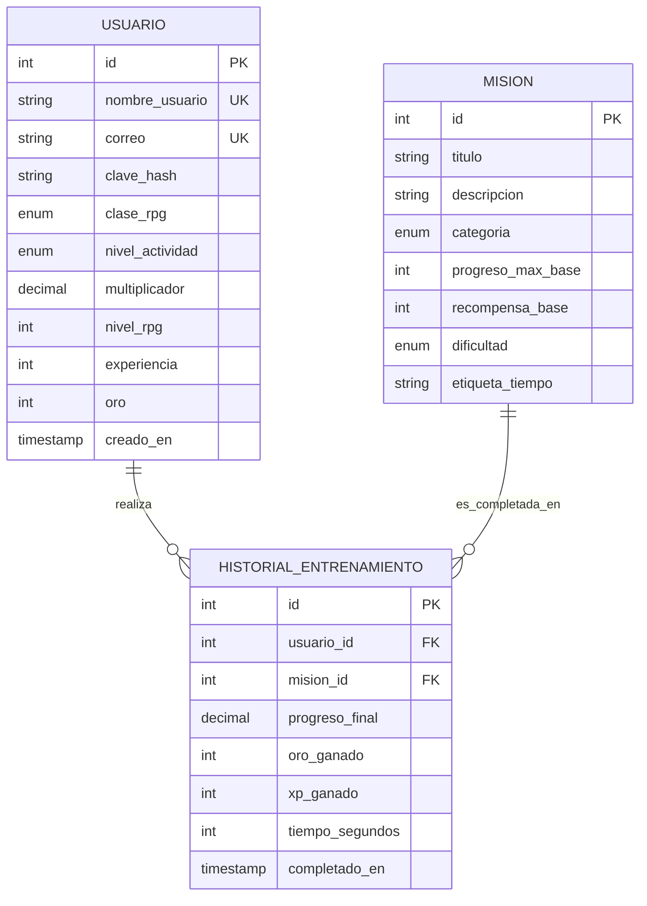

# 🗄️ Modelo de Base de Datos — QuestFit

Este documento detalla el diseño formal y la arquitectura de la base de datos de **QuestFit** bajo los estándares curriculares del módulo de **Bases de Datos** de **DAM**. Todo el diseño e identificadores están completamente en español.

---

## 1. Modelo Entidad-Relación (Diagrama E-R)
Representación lógica de nuestras entidades, atributos en español y relaciones de cardinalidad.

### Explicación de Cardinalidades:
*   **Un Usuario puede realizar de cero a muchos (0,N) Historiales de Entrenamiento.** (Al registrarse tendrá 0, y según entrene acumulará muchos registros en su historial).
*   **Una Misión puede aparecer en de cero a muchos (0,N) Historiales de Entrenamiento.** (Muchos usuarios pueden completar la misma misión, o un mismo usuario puede hacerla varias veces si es diaria).
*   **La relación muchos a muchos (M:N) entre Usuarios y Misiones se rompe físicamente mediante la tabla asociativa `historial_entrenamientos`.**

---

## 2. Modelo Relacional (Esquema Físico)
Estructuración de tablas con tipos de datos nativos de **MySQL**, claves primarias (**PK**), claves foráneas (**FK**) y restricciones, con todas las columnas en español.

### A. Tabla: `usuarios`
Almacena el perfil físico y los stats RPG del jugador.
*   `id` **INT AUTO_INCREMENT (PK)**
*   `nombre_usuario` **VARCHAR(50) UNIQUE NOT NULL** (Identificador único para el Login).
*   `correo` **VARCHAR(100) UNIQUE NOT NULL** (Identificador único de correo).
*   `clave_hash` **VARCHAR(255) NOT NULL** (Contraseña encriptada por seguridad).
*   `clase_rpg` **ENUM('guerrero', 'explorador', 'mistico') NOT NULL** (Clase de héroe traducida).
*   `nivel_actividad` **ENUM('sedentario', 'moderado', 'activo') NOT NULL** (IPAQ inicial traducido).
*   `multiplicador` **DECIMAL(3,2) NOT NULL DEFAULT 1.00** (Multiplicador de esfuerzo/premio).
*   `nivel_rpg` **INT NOT NULL DEFAULT 1**
*   `experiencia` **INT NOT NULL DEFAULT 0** (XP acumulada).
*   `oro` **INT NOT NULL DEFAULT 0**
*   `creado_en` **TIMESTAMP DEFAULT CURRENT_TIMESTAMP**

### B. Tabla: `misiones`
El catálogo estático de misiones y retos que ofrece la app.
*   `id` **INT AUTO_INCREMENT (PK)**
*   `titulo` **VARCHAR(100) NOT NULL**
*   `descripcion` **TEXT NOT NULL**
*   `categoria` **ENUM('cardio', 'fuerza', 'flexibilidad') NOT NULL** (Categorías en español).
*   `progreso_max_base` **INT NOT NULL** (Repeticiones o Kilómetros base sin escalar).
*   `recompensa_base` **INT NOT NULL** (Monedas base sin multiplicar).
*   `dificultad` **ENUM('facil', 'media', 'dificil', 'epica') NOT NULL** (Dificultades en español).
*   `etiqueta_tiempo` **VARCHAR(20) NOT NULL DEFAULT '24h'** (Ej: '2d 5h').

### C. Tabla: `historial_entrenamientos`
Tabla asociativa (M:N) que registra cada sesión deportiva completada.
*   `id` **INT AUTO_INCREMENT (PK)**
*   `usuario_id` **INT NOT NULL (FK ➔ usuarios.id ON DELETE CASCADE)**
    *   *Comportamiento:* Si un usuario borra su cuenta, todo su historial de entrenamientos se elimina automáticamente para no dejar huérfanos.
*   `mision_id` **INT NOT NULL (FK ➔ misiones.id ON DELETE RESTRICT)**
    *   *Comportamiento:* No se permite borrar una misión del catálogo si algún usuario ya la ha completado en el pasado (mantiene la integridad de datos).
*   `progreso_final` **DECIMAL(5,2) NOT NULL** (Distancia exacta o repeticiones ejecutadas).
*   `oro_ganado` **INT NOT NULL** (Oro definitivo cobrado aplicando el multiplicador).
*   `xp_ganado` **INT NOT NULL** (Experiencia definitiva cobrada).
*   `tiempo_segundos` **INT NOT NULL** (Duración en segundos registrada por el cronómetro).
*   `completado_en` **TIMESTAMP DEFAULT CURRENT_TIMESTAMP**

---

## 3. Análisis de Normalización (Formas Normales)
La normalización es el proceso de organizar los datos en una base de datos para evitar la redundancia y asegurar la integridad. Demostraremos que nuestro diseño cumple con la **Tercera Forma Normal (3FN)**, el estándar de calidad en la industria.

### 1ª Forma Normal (1FN): Atomicidad y Claves
> *Requisito: Todos los atributos deben ser atómicos (no divisibles) y no deben existir grupos repetitivos.*
*   **Cumplimiento:**
    *   Cada columna almacena un único valor (ej. `correo` almacena un solo correo, no una lista separada por comas).
    *   No hay listas ni arrays integrados en las tablas.
    *   Cada tabla posee una clave primaria unívoca (`id`).
    *   **Estado:** **Cumple con la 1FN.**

### 2ª Forma Normal (2FN): Dependencia Funcional Completa
> *Requisito: Estar en 1FN y que todos los atributos que no forman parte de la clave primaria dependan de manera funcional completa de la clave primaria.*
*   **Cumplimiento:**
    *   En las tablas `usuarios` y `misiones`, todas las columnas dependientes (como `nombre_usuario` o `titulo`) dependen del 100% de su clave surrogate `id`. No hay claves compuestas en estas entidades.
    *   En `historial_entrenamientos`, columnas como `oro_ganado` o `tiempo_segundos` dependen de la tupla completa del entrenamiento (`id`), no de una parte de ella.
    *   **Estado:** **Cumple con la 2FN.**

### 3ª Forma Normal (3FN): Ausencia de Dependencias Transitivas
> *Requisito: Estar en 2FN y que ningún atributo que no sea clave dependa transitivamente de otra columna que tampoco sea clave.*
*   **Cumplimiento:**
    *   En `usuarios`, stats como `oro` o `experiencia` dependen directamente del usuario (`id`), no dependen de su clase `clase_rpg` de manera transitiva.
    *   En `misiones`, la dificultad o categoría son propiedades exclusivas e intrínsecas de la misión, no dependen de otro atributo intermedio.
    *   **Estado:** **Cumple con la 3FN (Diseño Óptimo).**
