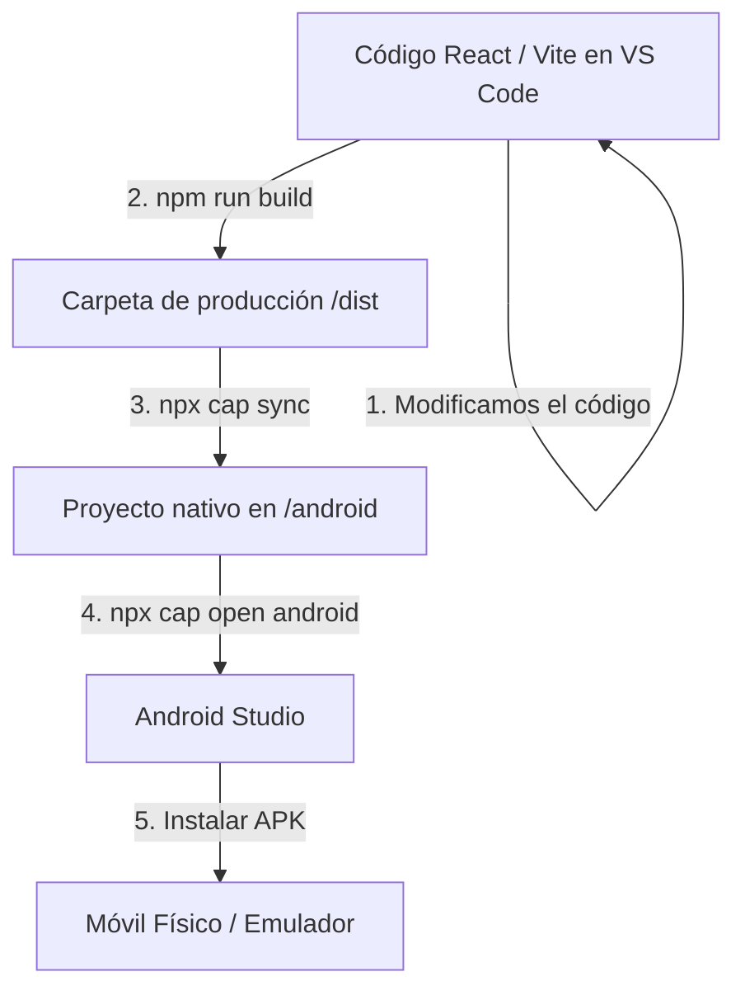

# 📱 Flujo de Trabajo Multiplataforma con Capacitor

¡Esta es la gran pregunta de todo estudiante de **DAM**! La respuesta corta y directa es: **Seguiremos operando e implementando código desde lo que tenemos creado aquí, pero crearemos un puente nativo hacia Android Studio.**

No vamos a reescribir la aplicación en Android Studio usando Kotlin o Java nativo. Hacer eso tiraría a la basura todo tu espectacular diseño visual, tus temas dinámicos (Obsidian, Parchment) y tu lógica en React, y además te obligaría a reescribirlo otra vez en Swift para iOS.

---

## 🌉 1. ¿Cómo funciona el "Puente" (Capacitor)?

**Capacitor** (desarrollado por el equipo de Ionic) es el estándar de la industria para desarrollo híbrido moderno.
1.  Nosotros seguimos programando nuestra aplicación en **React (TypeScript + CSS)** dentro de VS Code.
2.  Al compilar el proyecto (`npm run build`), Vite empaqueta todo en la carpeta `dist/` (HTML, CSS y JS ultra optimizados).
3.  **Capacitor coge esa carpeta `dist/` y la incrusta dentro de un contenedor nativo (WebView)** extremadamente optimizado que se ejecuta a pantalla completa en el móvil del usuario.
4.  Capacitor genera automáticamente una carpeta `android/` en nuestro proyecto que contiene un **proyecto nativo real de Android Studio**.

### Esquema del Flujo de Trabajo Multiplataforma:


---

## 🚀 2. Guía Paso a Paso para Exportar a Android Studio hoy mismo

Podemos inicializar el soporte nativo de Android en tu actual carpeta `Gremio` ejecutando estos sencillos comandos en tu consola:

### Paso 1: Instalar las dependencias de Capacitor
Ejecutamos en la terminal de tu proyecto:
```bash
npm install @capacitor/core @capacitor/cli
```

### Paso 2: Inicializar la configuración de Capacitor
Le decimos a Capacitor el nombre de tu aplicación y su identificador de paquete (el `applicationId` que verás en Gradle):
```bash
npx cap init QuestFit com.questfit.app --web-dir=dist
```

### Paso 3: Añadir la plataforma de Android
Instalamos el SDK de Android para Capacitor y agregamos la carpeta nativa:
```bash
npm install @capacitor/android
npx cap add android
```
*¡Listo! Verás que ha aparecido una carpeta llamada `android` en la raíz de tu proyecto. Esa carpeta es un proyecto Gradle de Android completo.*

---

## 🛠️ 3. ¿Cómo operamos en el día a día a partir de ahora?

Tu rutina como desarrollador multiplataforma será sumamente cómoda y profesional:

1.  **Programas en VS Code:** Haces cambios en React (ej: agregas el GPS, modificas estilos, etc.).
2.  **Compilas en Web:** Creas el bundle de producción de Vite:
    ```bash
    npm run build
    ```
3.  **Sincronizas con el móvil:** Copias la carpeta `dist` actualizada dentro del proyecto de Android Studio de forma automática:
    ```bash
    npx cap sync
    ```
4.  **Abres Android Studio:**
    ```bash
    npx cap open android
    ```
5.  **Ejecutas en tu móvil:** Android Studio se abrirá directamente con tu proyecto cargado. Solo tienes que conectar tu teléfono real por USB (con la Depuración USB activada en Ajustes de Desarrollador) y hacer clic en el botón de **Play (Run App)** de Android Studio. ¡La app se instalará en tu móvil y se abrirá al instante!

---

## 🎯 4. Accediendo al Hardware Nativo (GPS y Wearables)

Al estar en Android Studio, tu aplicación ganará "superpoderes" nativos a través de los **Plugins de Capacitor**:
*   **Geolocalización Nativa:** Si la Geolocalización Web falla en segundo plano, ejecutaremos:
    ```bash
    npm install @capacitor-community/background-geolocation
    ```
    Este plugin inyecta código Java nativo en la carpeta `android/` para registrar las coordenadas GPS con total precisión en segundo plano aunque el móvil esté bloqueado en el bolsillo del usuario.
*   **Sincronización con Smartwatch (WearOS):**
    En tu carpeta `android/`, podrás añadir un módulo nativo de WearOS en Android Studio que corra código Kotlin para comunicarse con el reloj mediante la *Wear Data Layer*, puenteando los datos de vuelta a tu interfaz web de React.
