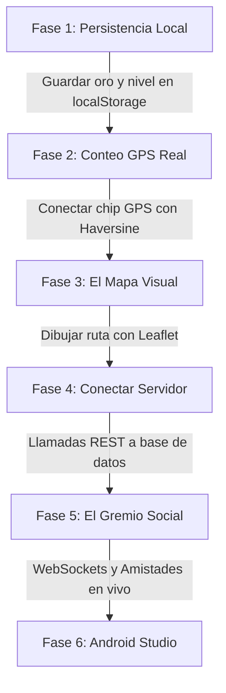

# 🧭 QuestFit — Ruta de Aprendizaje y Desarrollo Incremental (DAM)

¡Bienvenido a tu plan de estudio y desarrollo personalizado para **QuestFit**! Como estudiante del grado de **Desarrollo de Aplicaciones Multiplataforma (DAM)**, tu objetivo es comprender cada pilar del software sin que el código se convierta en una caja negra. 

Esta ruta está diseñada para ofrecerte un aprendizaje gradual, donde cada fase añade un concepto técnico clave del grado y te premia con una mejora funcional inmediata y muy visual.

## 📈 Diagrama de la Ruta de Desarrollo

---

## 💎 Fase 1: Persistencia e Historial
> **Concepto clave de DAM:** *"Memoria local en el dispositivo" (Almacenamiento persistente).*

### 🛠️ ¿Qué aprenderás?
*   Cómo funciona el **`localStorage`** del navegador/PWA.
*   Su equivalencia nativa en dispositivos móviles: **`SharedPreferences`** en Android o **`NSUserDefaults`** en iOS.
*   Cómo gestionar el ciclo de vida del estado en React para que lea del disco al arrancar la app y escriba en el disco al conseguir logros.

### 🎯 El objetivo práctico
Actualmente, si completas una misión, ganas oro y experiencia, pero al refrescar la pantalla todo vuelve a empezar. En esta fase haremos que el Oro, la Experiencia (XP), el Nivel de tu personaje y la lista de misiones completadas **se queden grabados de forma permanente**.

### 🎁 La recompensa visual
*   Podrás cerrar el navegador del móvil, volver al día siguiente, y ver que tu personaje sigue teniendo su nivel, sus monedas y sus progresos tal y como los dejaste.
*   Crearemos una vista sencilla de "Historial de Entrenamientos" para recordar qué misiones has superado y en qué fecha.

---

## 📍 Fase 2: Conteo GPS Real en Calle
> **Concepto clave de DAM:** *"Sensores de hardware y matemáticas espaciales".*

### 🛠️ ¿Qué aprenderás?
*   Cómo pedir permisos de hardware y capturar coordenadas GPS en tiempo real con la **API de Geolocalización** (`navigator.geolocation.watchPosition`).
*   La **Fórmula del Haversine**: cálculo matemático trigonométrico fundamental para medir la distancia real entre dos puntos en una esfera (la Tierra) usando latitud y longitud.

### 🎯 El objetivo práctico
En las misiones de Cardio (como *"Maratón del Guerrero"*), eliminaremos los botones manuales de incremento. Al pulsar *"Iniciar Ejercicio"* y empezar a andar o correr por tu calle, el chip GPS del móvil registrará tus pasos y el marcador de kilómetros (`0.0 km -> 0.1 km -> 0.2 km`) **subirá de forma completamente automática**.

### 🎁 La recompensa visual
*   Un cronómetro deportivo real y funcional en tu bolsillo.
*   Voz sintetizada y vibraciones automáticas cada vez que completes 1 kilómetro real.

---

## 🗺️ Fase 3: Tu Ruta en un Mapa Oscuro
> **Concepto clave de DAM:** *"Consumo de librerías externas y renderizado gráfico (Canvas)".*

### 🛠️ ¿Qué aprenderás?
*   Cómo integrar librerías externas de mapas de código abierto como **Leaflet.js** y mapas de **OpenStreetMap** (100% gratuito, sin necesidad de meter tarjetas de crédito ni pagar cuotas a Google Maps).
*   Cómo dibujar trazos polilineales dinámicos (`polyline`) sobre coordenadas dinámicas en un hilo de renderizado.

### 🎯 El objetivo práctico
Añadiremos una caja de mapa con estilo oscuro (Cyberpunk / Obsidian) en la pantalla de entrenamiento activo. A medida que te desplaces, el mapa se centrará en tu posición y dibujará una línea de color neón con el recorrido exacto que has hecho.

### 🎁 La recompensa visual
*   Tu aplicación tendrá la misma calidad visual y funcional que apps comerciales de primer nivel como **Garmin Connect** o **Strava**. Un factor diferencial excelente para convencer al tribunal de tu grado DAM.

---

## 🌐 Fase 4: Conexión con tu Servidor (Backend + DB)
> **Concepto clave de DAM:** *"Arquitectura Cliente-Servidor y persistencia relacional".*

### 🛠️ ¿Qué aprenderás?
*   Cómo realizar peticiones HTTP asíncronas (`fetch` / `Axios`) en React utilizando los verbos estándar de una **API REST** (`GET`, `POST`, `PUT`).
*   Cómo estructurar una base de datos relacional (como **PostgreSQL** o **MySQL**) en tu servidor para almacenar perfiles de usuario.

### 🎯 El objetivo práctico
Daremos el salto de guardar datos localmente a guardarlos en la nube. Conectaremos tu frontend en React con tu servidor backend (por ejemplo, desarrollado en **Java Spring Boot**, que es el estándar académico del grado).

### 🎁 La recompensa visual
*   **Pantalla de Login y Registro:** Podrás iniciar sesión con tu cuenta desde cualquier dispositivo (tu ordenador portátil, tu PC de torre o tu móvil) y tus estadísticas de QuestFit estarán perfectamente sincronizadas y a salvo en internet.

---

## 👥 Fase 5: El Gremio Social (Lobbies, Rankings y Piques)
> **Concepto clave de DAM:** *"Comunicación en tiempo real (WebSockets) y relaciones Many-to-Many en base de datos".*

### 🛠️ ¿Qué aprenderás?
*   Cómo implementar conexiones persistentes en tiempo real usando **WebSockets** (en lugar de peticiones HTTP tradicionales) para sincronizar dos jugadores en vivo.
*   Cómo diseñar tablas de relaciones de Muchos a Muchos (`ManyToMany`) para el sistema de solicitudes de amistad y amigos agregados en la base de datos relacional.

### 🎯 El objetivo práctico
Picarse y competir es el motor de los deportistas jóvenes. Añadiremos funciones sociales de gran impacto:
1.  **Lobby Cooperativo / Duelo en Vivo:** Dos amigos pueden iniciar un entrenamiento a la vez. Mientras corren, verán la barra de progreso de su amigo avanzar en su propia pantalla en tiempo real.
2.  **Tablón de Rankings Semanales:** Un ranking dinámico y ordenable donde verás qué amigo ha ganado más Oro, EXP o kilómetros esta semana.
3.  **Notificaciones de Pique:** Avisos push dentro de la app cuando un amigo supera tu récord: *"¡Tu amigo Juan acaba de superarte en dominadas! Recupera tu puesto."*

### 🎁 La recompensa visual
*   Un tablón de clasificación glorioso con efecto de podio (1º, 2º y 3º puesto) con brillos metálicos y destellos.
*   Comparadores de barra de progreso neón enfrentados durante el entrenamiento activo.

---

## 📱 Fase 6: El Salto a Android Studio y Smartwatch
> **Concepto clave de DAM:** *"Empaquetado de aplicaciones multiplataforma y comunicación híbrida".*

### 🛠️ ¿Qué aprenderás?
*   Cómo utilizar **Capacitor** para envolver tu código React en un proyecto Gradle real dentro de **Android Studio**.
*   Cómo generar tu primer archivo **`.apk`** firmado e instalarlo en tu móvil físico como una app del sistema.
*   Sincronización Bluetooth entre dispositivos móviles y relojes inteligentes (**WearOS** / **watchOS**).

### 🎯 El objetivo práctico
Verás tu aplicación convertida en una app móvil real. Desaparecerá la barra del navegador y la app se abrirá a pantalla completa con su propio icono de QuestFit en tu escritorio del móvil.

### 🎁 La recompensa visual
*   Tu proyecto final de grado DAM completamente finalizado, robusto, multidispositivo y listo para ser expuesto con la máxima calificación ante tu tribunal.

---

## 🧭 ¿Cómo empezamos?

Nuestra propuesta pedagógica es iniciar por la **Fase 1: Persistencia e Historial**. Es la forma más sencilla y lógica de aprender a manipular la persistencia de datos local en React y te dará una comprensión inmediata de cómo actúan las bases de datos de configuración de tu teléfono.

¡Dime cuando estés listo para comenzar y guiaremos tu aprendizaje paso a paso!eact y te dará una comprensión inmediata de cómo actúan las bases de datos de configuración de tu teléfono.

¡Dime cuando estés listo para comenzar y guiaremos tu aprendizaje paso a paso!
