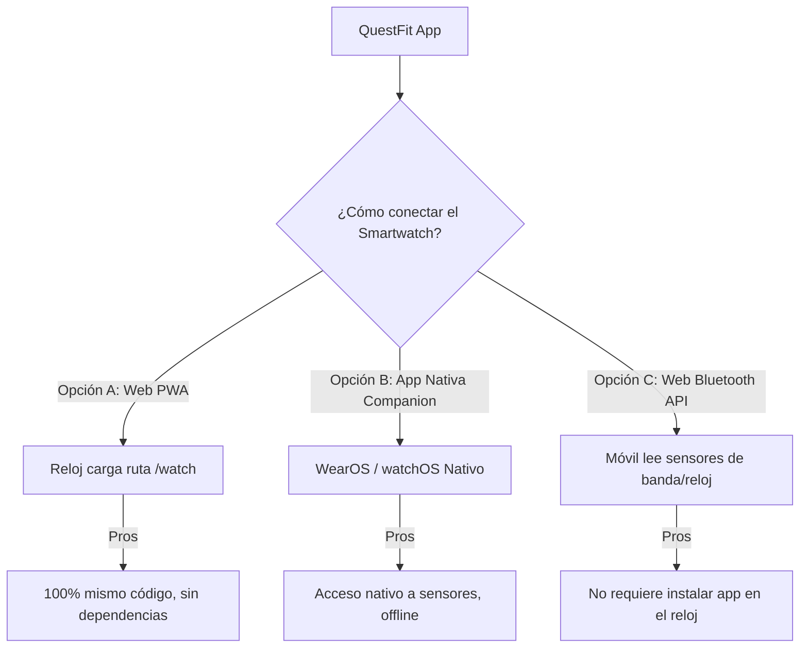
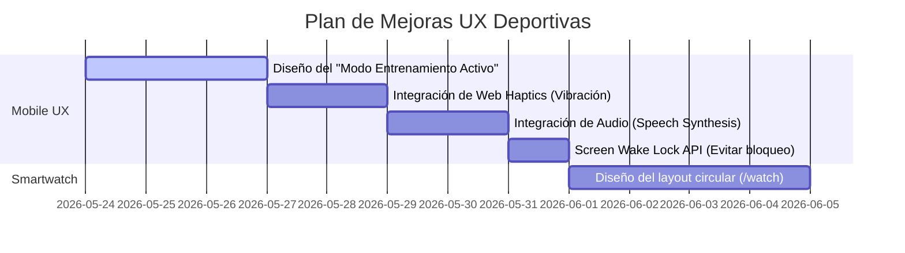

# 🏃 QuestFit — Estrategia de UX Deportiva y Smartwatch

¡Hola! Tras examinar a fondo la estructura actual del proyecto (una SPA móvil en React 19 + TypeScript + Tailwind CSS v4, con un elegante sistema de temas y layouts optimizados), he preparado este análisis estratégico.

Dado que la finalidad principal de **QuestFit** es llevarla encima mientras hacemos deporte, la experiencia de usuario (UX) debe diseñarse bajo condiciones extremas: **pantalla en constante movimiento (corriendo), manos sudadas, luz solar directa y fatiga física.**

---

## 📱 1. Auditoría de UX para Deporte (Móvil)

Actualmente, QuestFit tiene un diseño visual espectacular (de nivel premium), pero está pensado para ser consultado en reposo (ver misiones, cambiar temas). Si el usuario está corriendo o levantando pesas, la interfaz actual presentaría dificultades. Aquí tienes las mejoras clave para el entorno deportivo:

### A. "Modo Entrenamiento Activo" (Sesión en Curso)
*   **Problema:** Al pulsar "Continuar Misión", no pasa nada dinámico. La app sigue mostrando todas las misiones.
*   **Solución UX:** Implementar una **Pantalla de Enfoque de Misión Activa**. Al iniciar una misión, el layout completo debe cambiar a un "Modo Deportista" que maximice la legibilidad:
    *   **Números gigantes:** El progreso (ej: `3.2 / 5 km` o `35 / 80 flexiones`) y el cronómetro deben ocupar el 60% de la pantalla.
    *   **Botones masivos y táctiles:** Botones de "Pausa" y "Completar" enormes en la parte inferior, fácilmente pulsables con el pulgar mientras corres.
    *   **Incrementadores rápidos:** En misiones de fuerza, botones gigantes de `+1` o `+5` repeticiones para registrar el progreso sin tener que usar el teclado.

### B. APIs Nativas Web que marcan la diferencia en Deporte
Para que una web-app se sienta como una aplicación nativa de primer nivel en el móvil durante el deporte, debemos usar estas tres APIs del navegador:

1.  **Screen Wake Lock API (`navigator.wakeLock`):**
    > [!IMPORTANT]
    > **Evitar que la pantalla se apague:** No hay nada más frustrante para un deportista que tener que desbloquear el móvil con el dedo sudado cada 30 segundos para ver cuánto le queda de carrera. Con esta API, bloqueamos la suspensión de la pantalla automáticamente mientras la misión esté activa.
2.  **Web Speech API (`window.speechSynthesis`):**
    > [!TIP]
    > **Retroalimentación por Voz:** Permite al móvil "hablar" al usuario. Al completar hitos o finalizar la misión, la app puede decir: *"¡Misión 'Maratón del Guerrero' completada! Has ganado 500 de oro y 50 de experiencia"*. Así el usuario no tiene que mirar la pantalla en absoluto.
3.  **Vibration API (`navigator.vibrate`):**
    > [!NOTE]
    > **Haptic Feedback:** Vibraciones cortas cuando se inicia, pausa o incrementa el progreso, y una vibración larga y rítmica al completar la misión para dar un subidón de dopamina táctil.

### C. Contraste y Accesibilidad Exterior
*   **Brillo Solar:** Bajo la luz del sol directa, los colores oscuros del tema *Obsidiana* o *Bosque Profundo* son difíciles de ver.
*   **Solución:** Crear un modo de alto contraste para exteriores o configurar el tema *Pergamino* (modo claro) de forma que con un solo toque aumente el contraste visual.

---

## ⌚ 2. ¿Cómo integramos el Smartwatch?

Para un estudiante de **DAM (Desarrollo de Aplicaciones Multiplataforma)**, el desarrollo para dispositivos corporales (Wearables) es uno de los temas más interesantes. Dependiendo del alcance que quieras dar al proyecto, tenemos **tres caminos arquitectónicos** para llevar QuestFit a tu muñeca:

### Opción A: Companion Web App / PWA en Reloj (El camino 100% Web)
Los relojes inteligentes modernos (especialmente los WearOS basados en Android como Samsung Galaxy Watch o Xiaomi Watch) tienen navegadores web o permiten abrir PWAs.
*   **Cómo se hace:**
    *   En nuestro proyecto React, creamos una ruta específica `/watch` (o un condicional de diseño basado en la anchura de la pantalla).
    *   Diseñamos una interfaz ultra-simplificada, **circular** o cuadrada de apenas 150px de ancho.
    *   Esta pantalla solo mostraría: *Nombre de la misión activa, Barra de progreso circular y un Botón gigante de pause/play.*
*   **Ventaja:** Mantienes todo el código en el mismo repositorio Vite + React. Es extremadamente rápido de probar y mantener.
*   **Inconveniente:** Apple Watch no tiene un navegador web accesible para el usuario por defecto (aunque sí puede abrir enlaces que reciba por mensaje).

### Opción B: Aplicación Nativa Companion (La vía académica DAM premium)
Dado que tu Roadmap en la **Fase 6** contempla convertir la web en app nativa usando **Capacitor**, esta es la mejor opción a largo plazo y la que más valor académico te dará.
*   **Cómo se hace:**
    1.  **Capacitor Bridges:** Capacitor te permite crear plugins para comunicar el código web de tu móvil con código nativo Android/iOS.
    2.  **Lado Reloj (Nativo):**
        *   **Android (WearOS):** Creas una mini-app nativa usando **Kotlin** y **Jetpack Compose para Wear OS** en Android Studio.
        *   **iOS (watchOS):** Creas una mini-app nativa usando **Swift** y **SwiftUI** en Xcode.
    3.  **Comunicación:** Utilizas los SDKs nativos de sincronización de datos:
        *   En Android: **Google Wearable Data Layer API**.
        *   En iOS: **Watch Connectivity framework**.
        *   El reloj se suscribe a los cambios del móvil (p. ej., cuando inicias una misión en el móvil, este envía un mensaje al reloj para que se active su pantalla de entrenamiento).
*   **Ventaja:** Rendimiento impecable, acceso a los sensores internos del reloj (pulsómetro, podómetro nativo) y funciona de forma independiente (puedes salir a correr sin el móvil y luego sincronizar).
*   **Inconveniente:** Requiere programar en Kotlin y Swift.

### Opción C: Conexión de Sensores vía Bluetooth (El "Atajo Inteligente")
¿Y si en lugar de crear una aplicación que corra *dentro* del reloj, hacemos que tu aplicación del móvil se conecte directamente al smartwatch o a una banda de frecuencia cardíaca por Bluetooth?
*   **Cómo se hace:**
    *   Usamos la **Web Bluetooth API** (soportada en navegadores móviles Chrome/Android) o un plugin nativo de Bluetooth BLE en Capacitor.
    *   La app móvil escanea dispositivos cercanos y se conecta a tu reloj o sensor de pecho mediante el estándar GATT (Generic Attribute Profile).
    *   **Resultado:** En la pantalla del móvil se ve el pulso en tiempo real proveniente de tu reloj mientras haces la misión, ¡haciendo que la app se sienta totalmente integrada con tu hardware deportivo!

---

## 🛠️ 3. Propuesta de Plan de Trabajo para la Experiencia Deportiva

Para llevar la aplicación al siguiente nivel de usabilidad antes de la fase de base de datos, te propongo priorizar estos cambios visuales y funcionales en el Frontend:

### ¿Por dónde empezamos?
Podemos implementar el **"Modo Entrenamiento Activo"** directamente en nuestra aplicación actual de React. 

Cuando el usuario pulse **"Continuar Misión"** (o "Iniciar Misión"), podemos abrir un **Drawer (panel deslizante inferior gigante)** usando la librería `vaul` (que ya tienes instalada en tu `package.json`, ¡un acierto excelente!) o una vista superpuesta que tome el control total. En esa vista implementaremos:
1.  Un temporizador o contador visual enorme.
2.  Un sistema de vibración cuando pulses los botones.
3.  Voz sintetizada que te felicite al terminar.

¿Qué te parece este enfoque estratégico? ¿Quieres que empecemos a diseñar e implementar la interfaz del **"Modo Entrenamiento Activo"** en el móvil, o prefieres que preparemos primero la estructura/ruta circular para el **Smartwatch**?
